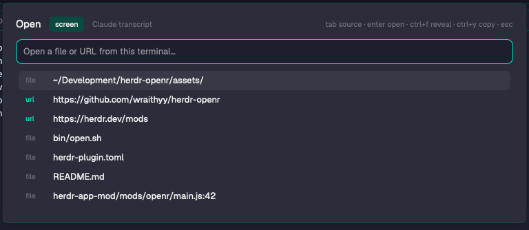

# Openr

A popup listing the file paths and URLs recently mentioned in the focused terminal, newest first.
Enter opens a URL in the browser, or a file in your editor in a new tab.

## What you see

- A popup at the top of the window, 760px wide and 0.6 of the window high, with a `popover`
  background and 18px padding.
- Header row: "Open" in 15px semibold, then two source chips, "screen" and "Claude transcript".
  The active chip has a `selected` background and `foreground` text; the other is `dim`. A `dim`
  11px key hint on the right: `tab source · enter open · ctrl+f reveal · ctrl+y copy · esc`.
- A 36px input with a 1px `accent` border. Placeholder: "Open a file or URL from this terminal…".
- Up to 14 rows, 28px high. Each row has a 30px kind label (`url` in `accent`, `file` in `dim`) and
  the text as it appeared in the terminal, truncated. A folder gets a trailing `/`.
- Status text instead of rows: "reading…", "nothing openable here" or "no Claude transcript for
  this terminal".

## How it behaves

- It reads the terminal that was focused when the popup opened.
- **screen** (the default) reads that terminal's visible screen. **Claude transcript** reads the
  Claude Code session that runs in it: tool-call file paths and message text from the last 1000
  JSONL lines. Tab switches between the two and reads again.
- Candidates are URLs (`https?://`) and path-like tokens: absolute paths, `a/b` paths, and names
  with an extension. A token can carry `:line`. They are deduplicated, newest mention first, up to
  300.
- A path is kept only when it exists. `~` is expanded and relative paths are resolved against the
  terminal's folder. URLs are always kept.
- Typing filters by subsequence. Up/Down (or ctrl+p/ctrl+n) move the selection.
- Enter: a URL runs `open <url>`. A file opens a new tab in the terminal's folder that runs
  `nvim +<line> <file>`. The tab is named after the file.
- ctrl+f reveals the file in Finder (`open -R`); for a URL it opens the URL. ctrl+y copies the
  absolute path or the URL with `pbcopy` and shows a toast. Esc closes the popup.

## Built from

- `mods/openr/mod.json`: `place: "none"` and an overlay `{kind: "popup", at: "top", offset: 40,
  width: 760, height: 0.6}`. `keys.json` binds `cmd-o` to `mod.open:openr`.
- `herdr`: `focused()` for `terminal` and `cwd`, `hc(["read", t])` for the screen,
  `hc(["get", t, "--json"])` for the foreground program's `pid` and `cwd`, `readTextFile`,
  `exec` (`sh` for the existence checks, `open`, `pbcopy`), `run("tab.new", {name, folder, argv})`,
  `notify`, `closeOverlay`, and `theme()`.
- How the transcript is found: `~/.claude/sessions/<pid>.json` gives `sessionId`. The transcript is
  `~/.claude/projects/<cwd with / and . replaced by ->/<sessionId>.jsonl`.
- The editor is the `EDITOR` argv template at the top of `main.js`, with `{file}` and `{line}`
  placeholders.

## Watch out

- Terminal text is untrusted. Pass it only as argv items: `exec` arguments, `tab.new` `argv`, and
  `sh -c '…' sh "$@"` positional arguments. Never splice it into a shell string.
- Check all paths in one `sh` call (`[ -d ]` / `[ -e ]` in a loop), not one `exec` per path.
- Read `focused()` in `init`, before the popup takes the keyboard.
- macOS only as written (`open`, `pbcopy`). On Linux use `xdg-open` and `wl-copy`.
- There is no preview pane, and screen mode reads the visible screen only (no scrollback).

## Done when

- `herdr-app check mods/openr` passes.
- In a terminal that printed a path and a URL, `cmd-o` lists both, URL rows in the accent color.
  Enter on the file opens nvim at that line in a new tab. Enter on the URL opens the browser.
- In a Claude Code pane, Tab lists files the session edited. In a plain shell it shows "no Claude
  transcript for this terminal".
